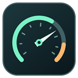

# Metrik



Metrik shows FPS, average frame time, and hardware metrics while you play on Windows. Hide the in-game overlay and monitor the same readings on an Android tablet over USB or your local network. The USB connection works without internet access.

## Download

| App | Requirements |
| --- | --- |
| [Metrik-Windows-x64.zip](https://github.com/huner-c/metrik/releases/latest/download/Metrik-Windows-x64.zip) | Windows x64 and the [.NET 10 Desktop Runtime (x64)](https://dotnet.microsoft.com/en-us/download/dotnet/10.0) |
| [Metrik-Tablet.apk](https://github.com/huner-c/metrik/releases/latest/download/Metrik-Tablet.apk) | Android 4.4 or later |

Extract the Windows ZIP to a folder and open `Metrik.exe`. To use the tablet dashboard, install the APK and keep Metrik running on your PC.

## Windows controls

- Bring the game to the foreground in windowed or **borderless fullscreen** mode. The overlay appears in the upper-left corner once Metrik receives DirectX frame data.
- Press `Ctrl + Shift + F10` to toggle the game overlay. Minimizing Metrik sends it to the notification area.
- Choose the values under **Overlay metrics** and adjust the text between 50% and 200% under **Overlay size**.
- Select **Show preview** to view the overlay on your desktop. The preview uses sample FPS and frame time values and live GPU readings.
- Select **Restart as administrator** if Windows requires elevated access for frame capture.

## Android dashboard

Tablet streaming is off by default. After connecting over USB or LAN, select **Hide game overlay** on Windows to keep FPS capture running on the tablet. The dashboard updates once per second. Each device stores its connection settings locally.

### USB cable

1. On your tablet, turn on **USB debugging** in **Developer options**. On the Galaxy Tab 4, tap **Settings → General → About device → Build number** seven times to reveal that menu.
2. Connect the tablet to the PC with a USB data cable. Unlock the tablet and approve the **Allow USB debugging** prompt.
3. In Metrik on Windows, select **Start USB stream**. Metrik looks for `adb.exe` and starts the local ADB server when needed. If prompted for a file, select `adb.exe` from Android SDK Platform-Tools. [Android SDK Platform-Tools](https://developer.android.com/tools/releases/platform-tools)
4. In the tablet app, open **Connection → USB cable**, enter the six-digit code shown on Windows, and select **Connect**. If the code is already saved, select **Connect** directly.

With the USB link active, you can unplug the PC’s Ethernet cable or turn off Wi-Fi. Metrik tries to reconnect automatically if you unplug and reconnect the USB cable.

### Local network

1. Connect the PC and tablet to the same local network. The PC can use Ethernet while the tablet uses Wi-Fi.
2. On Windows, select **Start LAN stream**. If the firewall blocks the connection, select **Allow LAN access**. Windows asks for administrator approval to allow UDP port 47937 from the local subnet for this copy of Metrik.
3. On the tablet, select **Connection → Local network** and enter the PC’s IP address and six-digit code shown on Windows.

Guest Wi-Fi can isolate devices. USB and LAN use the same pairing code.

## Metrics

| Area | Readings |
| --- | --- |
| Game | FPS, average frame time, game name, and DirectX API |
| Radeon GPU | Usage, temperature, hotspot, core and memory clocks, VRAM, fan speed, and power |
| CPU and RAM | CPU usage, Windows-reported clock speed, logical processor count, and RAM usage |

Metrik uses Windows Event Tracing (ETW) to track Direct3D 9 and DXGI (Direct3D 10, 11, and 12) presentation events. It measures successful `Present` calls from the busiest swap chain of the foreground process over a two-second window. The rate of presentation calls can differ from the number of frames displayed on the monitor, especially with frame generation.

When new frame data is delayed, Metrik marks the last reading after about two seconds. After five seconds, FPS and frame time show `—`. Hardware readings update independently. Unavailable sensors also show `—`.

The overlay passes clicks through to the game and may be hidden in exclusive fullscreen mode. GPU readings depend on the AMD Radeon driver and available sensors. With several adapters, Metrik prefers the primary Radeon adapter.

For optional CPU package temperature and power, use a build of LibreHardwareMonitor that can bind its web server to `127.0.0.1`. Under **Options → Remote Web Server**, set the address to `127.0.0.1` and the port to `8085`, then select **Run**. Leave authentication disabled for this loopback connection. Metrik displays the CPU package readings supplied by LibreHardwareMonitor. [LibreHardwareMonitor](https://github.com/LibreHardwareMonitor/LibreHardwareMonitor)

## Build from source

For Windows, run these commands from the project root with the .NET 10 SDK. If Metrik is running, exit it from the notification area before publishing.

```powershell
dotnet publish -c Release --self-contained false -o .\dist\Metrik-Windows-USB -p:DebugType=None -p:DebugSymbols=false
Copy-Item .\README.md .\dist\Metrik-Windows-USB\README.md -Force
```

For Android, install JDK 17 or later, Android SDK platforms 19 and 35, and Build Tools 35.0.0. Set `JAVA_HOME` and `ANDROID_HOME`, then run the build script.

```powershell
.\android\build.ps1
```

The APK is written to `android/build/Metrik-Tablet.apk`. The build prompts for the signing password. For non-interactive builds, set `METRIK_ANDROID_KEYSTORE_PASSWORD`. Keep the local key in `android/.signing` and its password to install later builds as updates.

[Windows ETW](https://learn.microsoft.com/windows/win32/etw/configuring-and-starting-an-event-tracing-session) · [AMD Display Library](https://gpuopen-librariesandsdks.github.io/adl/) · [Windows layered windows](https://learn.microsoft.com/windows/win32/winmsg/window-features#layered-windows)
